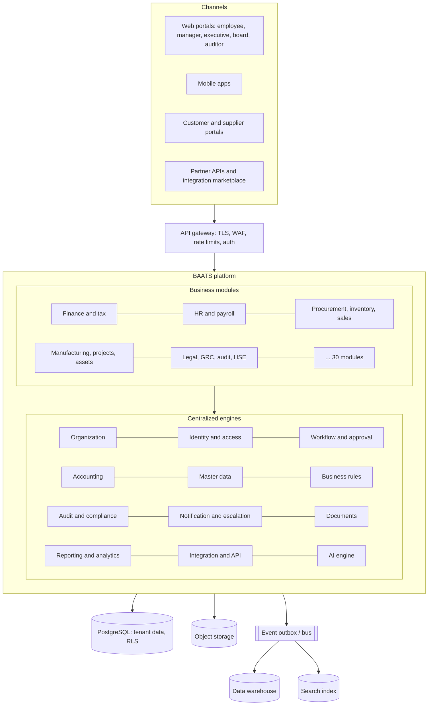

# 01. Enterprise system architecture

**Product:** BAATS Enterprise ERP, a complete enterprise business operating system.
**Tagline:** One Organization. One Platform. Complete Control.
**Status:** Phase 1 foundation. Capacity and availability figures in this document are design targets that must be proven by load and failover testing before any commercial commitment.

## 1. Design principles

1. **One platform, shared engines.** Every module (finance, HR, procurement and the other 27) uses the same organization, identity, workflow, audit, master-data, rules, notification, document, reporting, integration and AI engines. No module keeps its own users, approval logic or audit log.
2. **Configuration, not code.** Org structures, roles, approval matrices, business rules, custom fields and country rules are data. Each tenant changes them without a release, and upgrades never overwrite them.
3. **Secure by default.** Tenant isolation is enforced by the database, not only by application code. Every change and every denied access is in a tamper-evident audit trail.
4. **Modular monolith first, services where they pay off.** Modules are separate code packages with explicit interfaces and their own database schemas, deployed together at first. A module moves into its own service only when its scale or release cadence needs it (likely candidates: reporting, AI, integration, payroll calculation).
5. **Data flows once.** A record entered in one module is referenced, not copied, by others. Cross-module reactions run through domain events (transactional outbox), so procure-to-pay, order-to-cash and the other end-to-end processes have no re-keying.

## 2. Technology stack (recommendation)

| Layer | Choice | Why | Alternatives considered |
|---|---|---|---|
| Language | **TypeScript on Node.js 22 LTS** | One language for API, web and mobile (React Native) lets one team cover the full stack; strong typing; huge hiring pool; Node 22 runs TypeScript directly. | Java/Spring and C#/.NET are proven ERP choices with stronger heavy-batch performance. Payroll or MRP calculation services can be written in them later without changing the platform. |
| API | **Fastify**, REST + JSON, OpenAPI per module | Fast, schema-validated, low overhead. | NestJS (more structure, more weight); GraphQL can be added for the portals' read side. |
| Primary database | **PostgreSQL 16+** | ACID for financial postings; row-level security for tenant isolation; JSONB for configurable fields; partitioning; logical replication; mature HA (Patroni) and managed offerings on every cloud and on-premises. | Oracle and SQL Server (licence cost, weaker portability); distributed SQL (CockroachDB, YugabyteDB) kept as a later option for very large single tenants. |
| Cache and queues | Redis (cache, rate limits, sessions at scale); PostgreSQL outbox, then Kafka or Redpanda when event volume needs it | Start simple, scale out when measured. | RabbitMQ. |
| Analytics | Change data capture into a columnar warehouse (ClickHouse self-hosted, or BigQuery/Snowflake for SaaS) | Keeps reporting load off the transactional database. | Postgres read replicas only (fine for Phase 1 to 2). |
| Documents | S3-compatible object storage (AWS S3, Azure Blob, MinIO on-premises), encrypted, with immutability locks | Portable across cloud and on-premises. | |
| Search | OpenSearch | Global search across modules, permission-filtered. | |
| Web front end | React + TypeScript, shared design system, i18n with right-to-left support (Arabic, Urdu) | Same components for every portal. | Angular. |
| Mobile | React Native (Android and iOS) | Shares models and API client with the web. | Flutter. |
| Identity federation | OIDC and SAML 2.0 to Entra ID (Azure AD), Google, Okta; SCIM for automated provisioning | Enterprise SSO and joiner-mover-leaver automation. | |
| Runtime | Containers on Kubernetes (EKS, AKS, GKE, OpenShift or on-premises), Helm charts, GitOps (Argo CD) | Same artefacts for SaaS, private cloud, dedicated and on-premises. | |
| Observability | OpenTelemetry, Prometheus, Grafana, Loki; SIEM export | | |

This choice is the one contentious decision in Phase 1. Everything in the database layer (schemas, row-level security, triggers) is independent of the application language, so the core is portable if the team later prefers Java or .NET.

## 3. Logical architecture

### Engines and their Phase 1 status

| Engine | Responsibility | Phase 1 status |
|---|---|---|
| Organization | Configurable hierarchy levels, units, cost and profit centers, designations, employees, reporting lines, org chart | **Built** (`src/org`) |
| Identity and access | Users, password + TOTP MFA, sessions, lockout, roles, org-scoped grants, ABAC conditions, segregation of duties, delegation | **Built** (`src/iam`). SSO/SCIM in Phase 1b |
| Workflow and approval | Versioned no-code definitions, sequential and parallel steps, any/all/quorum, conditional steps, approval limits, maker-checker, delegation, escalation, full history | **Built** (`src/workflow`) |
| Audit and compliance | Append-only, hash-chained audit trail of all data changes and security events, verification | **Built** (`src/audit`, `db/migrations`) |
| Master data | Units of measure, items, customers and suppliers with governed activation and duplicate detection | **Built** (`src/mdm`), more domains each phase |
| Business rules | Declarative conditions used by grants and workflows | **Built** (core evaluator, `src/core/rules.ts`). Rule builder UI later |
| Accounting | Multi-company general ledger, journals, periods, multi-currency | **Built** (`src/fin`, Phase 2) |
| Notification and escalation | In-app inbox (built as workflow tasks); email, SMS, WhatsApp, push | Escalation built; channels Phase 1b |
| Document management | Storage, versions, retention, e-signature | Phase 1b |
| Reporting and analytics | Operational reports, dashboards, warehouse | Phase 5 (operational lists exist per module) |
| Integration and API | REST API (built), webhooks, event bus, connectors | API built; events Phase 1b |
| AI | Permission-aware assistant and models | Phase 5 |

## 4. Multi-tenancy and deployment models

* **Pooled SaaS (default):** many tenants share a database cluster; every tenant row carries `tenant_id` and PostgreSQL row-level security restricts each transaction to one tenant. The application connects as a role that cannot bypass RLS and has no write access to the audit log.
* **Dedicated tenant:** the same schema in a tenant-specific database or cluster, for large customers, data-residency needs (UAE, KSA, EU) or contractual isolation. Routing is by tenant, so the code is identical.
* **Private cloud and on-premises:** the same container images and Helm charts, with the customer's PostgreSQL, object storage and identity provider.
* **Hybrid:** on-premises operational database with cloud analytics or AI, connected over the integration engine.

See [02-data-architecture.md](02-data-architecture.md) for the data model.

## 5. Scalability and availability targets

| Target | Design approach | How it will be proven |
|---|---|---|
| 50,000+ employees per tenant | Indexed materialized org paths (subtree queries without recursion), paged lists, permission checks per request in a few indexed queries | Synthetic tenant with 50k employees, 5k org units, 100k role assignments |
| 10,000 concurrent active users | Stateless API pods behind a load balancer, autoscaling; PgBouncer connection pooling; Redis cache for permission sets; read replicas for reports | k6 or Gatling load tests on agreed user journeys with p95 latency targets (for example 300 ms for reads, 800 ms for postings) |
| Millions of transactions | Time-based partitioning of ledger, audit and history tables; archival tiers; CDC to the warehouse | Volume tests with multi-year data |
| 99.99% for agreed critical services | Multi-AZ Kubernetes; PostgreSQL with synchronous standby and automatic failover (Patroni or managed equivalent); no single points of failure; zero-downtime deploys (expand-contract migrations) | Failover drills and chaos tests; measured monthly availability |

99.99% allows about 4.3 minutes of downtime a month. It applies to defined critical services (login, approvals, postings), not to batch or analytics.

## 6. Security architecture (summary)

* **Zero trust:** every request is authenticated and authorized; no trust from network location. Service-to-service traffic uses mTLS.
* **Identity:** local accounts (scrypt hashes, password policy, lockout, TOTP MFA) are built. Phase 1b adds OIDC/SAML SSO, Active Directory via Entra ID or LDAP, SCIM provisioning, and WebAuthn.
* **Authorization:** roles grant permissions over an org subtree, narrowed by attribute conditions (amounts, currencies, countries). Segregation-of-duties rules block conflicting grants. Users cannot assign roles to themselves. Field-level and record-level rules extend the same engine.
* **Data protection:** TLS 1.2+ in transit; encryption at rest (database, backups, object storage) with KMS or HSM-held keys; per-tenant keys for dedicated tenants; secrets in a vault, never in code. Sensitive columns (salaries, bank accounts, national IDs) get column-level encryption and masking in Phase 2.
* **Audit:** all changes to governed tables are captured by database triggers with before and after values (secrets removed), plus login, logout, MFA and access-denied events. Entries are append-only and SHA-256 hash-chained per tenant; tampering, even by a database superuser, is detected by verification.
* **Privileged access:** platform operators use just-in-time, approved, time-boxed access; all operator actions are audited.
* **Operations:** SAST, dependency and container scanning in CI; DAST and annual penetration tests; SIEM integration; vulnerability SLAs.
* **Compliance mapping:** controls are designed to support ISO 27001, SOC 2 Type II, GDPR, UAE PDPL and KSA PDPL. Certification requires an audit of the operating organization, not only the software.

## 7. Financial foundation and BAATS Accounting

BAATS Accounting v10.86 (UAE edition) is the financial foundation. Its chart of accounts, posting rules, VAT treatment and corporate tax rules are carried over; its architecture is not, because it derives the ledger in the browser from editable documents, while an enterprise ledger must be stored, validated by the database and immutable. The Phase 2 accounting engine (`src/fin`) is the single posting API for every module. Details, mapping and the porting backlog: [06-finance-and-baats-accounting.md](06-finance-and-baats-accounting.md).

## 8. Integration architecture

* Versioned REST APIs (`/v1/...`) for every module, documented with OpenAPI, with OAuth2 client credentials for machine clients and per-tenant rate limits.
* **Transactional outbox:** domain events are written in the same transaction as the change and published to the event bus, so integrations and other modules see every committed change exactly once.
* Webhooks for customers; connector framework for banks (ISO 20022, host-to-host), tax authorities (UAE FTA e-invoicing via Peppol, ZATCA Fatoora, India GST IRP, EU Peppol), biometric devices, Microsoft 365, Google Workspace, email, SMS, WhatsApp, e-commerce and e-signature providers.

## 9. AI architecture (Phase 5)

The assistant runs as the signed-in user: every tool it calls goes through the same authorization engine, so it can never see or do more than the user. Read actions are logged; write actions are proposals that enter the normal approval workflow, so sensitive changes always have a human approver. Forecasting and anomaly detection run on the warehouse, not on the transactional database.

## 10. Backup and disaster recovery

| Item | Design |
|---|---|
| Database | Continuous WAL archiving (point-in-time recovery) plus daily full backups, encrypted, copied to a second region |
| Immutability | Object-lock (WORM) retention on backup buckets so ransomware or an operator cannot delete them |
| Single-tenant restore | Logical export per tenant (all rows with that `tenant_id`) on a schedule, restorable into a staging database for selective recovery |
| Documents | Versioned, replicated object storage with object lock |
| Targets | Critical services RPO 5 minutes or less, RTO 1 hour or less; restore drills every quarter |

## 11. Infrastructure and cost estimate (indicative)

Cloud list prices, single region with DR copy, before discounts. To be refined after load tests.

| Tier | Example | Monthly estimate |
|---|---|---|
| Development and test | 1 small Kubernetes cluster, 1 managed PostgreSQL (2 vCPU), object storage | USD 600 to 1,200 |
| SaaS launch (up to about 50 small tenants, 2,000 concurrent users) | 3-node cluster, PostgreSQL HA (8 vCPU primary + standby + replica), Redis, warehouse starter, monitoring | USD 4,000 to 8,000 |
| Large enterprise dedicated (50k employees, 10k concurrent) | 6 to 12 API nodes, PostgreSQL HA 32 vCPU with 2 replicas, Redis cluster, warehouse, search, DR region | USD 20,000 to 45,000 |

A full build of this scope is a multi-year programme. A realistic core team is 25 to 40 engineers plus product, QA, security and domain consultants (tax, payroll, accounting per country); see [05-roadmap.md](05-roadmap.md).
