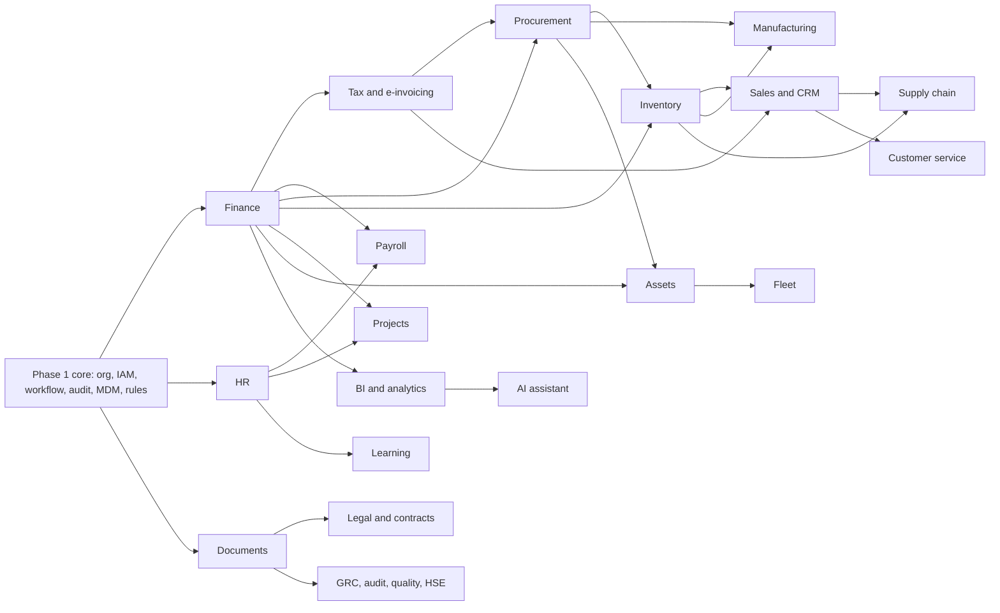

# 03. Module dependency matrix

## 1. Modules × centralized engines

**●** depends heavily, **○** uses. Every module uses Organization, Identity and access, Audit, Notification and Reporting, so those columns are omitted from the table and assumed for all 30 modules.

| # | Module | Workflow | Accounting | Master data | Rules | Documents | Integration | AI | Phase |
|---|---|---|---|---|---|---|---|---|---|
| 1 | Finance and accounting | ● | ● | ● | ● | ● | ● | ● | 2 |
| 2 | Taxation and e-invoicing | ○ | ● | ● | ● | ● | ● | ○ | 2 |
| 3 | Human resources | ● | ○ | ● | ● | ● | ○ | ○ | 2 |
| 4 | Payroll | ● | ● | ● | ● | ○ | ● | ○ | 2 |
| 5 | Procurement and purchasing | ● | ● | ● | ● | ● | ● | ○ | 2 |
| 6 | Inventory and warehouse | ○ | ● | ● | ● | ○ | ● | ● | 2 |
| 7 | Sales and CRM | ● | ● | ● | ● | ○ | ● | ● | 2 |
| 8 | Marketing | ○ | ○ | ● | ○ | ○ | ● | ● | 3 |
| 9 | Project management | ● | ● | ● | ○ | ● | ○ | ○ | 3 |
| 10 | Manufacturing and production | ● | ● | ● | ● | ○ | ○ | ● | 3 |
| 11 | Supply chain and logistics | ● | ● | ● | ● | ○ | ● | ● | 3 |
| 12 | Asset and maintenance | ● | ● | ● | ○ | ● | ○ | ● | 3 |
| 13 | Fleet and transportation | ● | ● | ● | ○ | ○ | ● | ● | 3 |
| 14 | IT service management | ● | ○ | ○ | ● | ○ | ● | ● | 4 |
| 15 | Legal and contracts | ● | ○ | ● | ○ | ● | ○ | ● | 4 |
| 16 | Governance, risk, compliance | ● | ○ | ○ | ● | ● | ○ | ● | 4 |
| 17 | Internal and external audit | ● | ○ | ○ | ○ | ● | ○ | ● | 4 |
| 18 | Quality management | ● | ○ | ● | ● | ● | ○ | ○ | 4 |
| 19 | Health, safety, environment | ● | ○ | ○ | ● | ● | ○ | ○ | 4 |
| 20 | Administration and facilities | ● | ○ | ● | ○ | ○ | ○ | ○ | 4 |
| 21 | Document management | ● | | ○ | ○ | ● | ● | ● | 4 |
| 22 | Learning and development | ● | ○ | ● | ○ | ● | ○ | ○ | 4 |
| 23 | Customer service | ● | ○ | ● | ● | ○ | ● | ● | 4 |
| 24 | Communication and collaboration | ○ | | ○ | | ● | ● | ○ | 4 |
| 25 | Strategy and performance | ● | ○ | ○ | ○ | ○ | | ● | 5 |
| 26 | Business intelligence | | ○ | ● | | | ● | ● | 5 |
| 27 | Research and development | ● | ● | ● | ○ | ● | | ○ | 5 |
| 28 | ESG and sustainability | ● | ○ | ● | ● | ● | ● | ● | 5 |
| 29 | Board and corporate secretariat | ● | ○ | ○ | | ● | | ○ | 4 |
| 30 | Master data management | ● | | ● | ● | ○ | ● | ● | 1 |

## 2. Module-to-module dependencies (build order)

A module can only be built after the modules it depends on. Arrows read "is needed by".

## 3. End-to-end processes

Each process crosses modules without re-keying. The record created first is referenced by everything after it.

| Process | Flow | Key integration points |
|---|---|---|
| Procure to pay | Requisition → approval → RFQ → PO → goods receipt → supplier invoice (3-way match) → payment | Supplier from MDM; budget check in Finance; receipt updates Inventory; invoice posts AP and input tax; payment file to bank |
| Order to cash | Lead → opportunity → quote → sales order → delivery → invoice → e-invoice clearance → receipt | Customer and credit limit from MDM; stock reservation; revenue and output tax postings; e-invoice to FTA/ZATCA/IRP |
| Hire to retire | Requisition → recruitment → offer → onboarding → user provisioning → attendance and leave → payroll → appraisal → exit and access revocation | Employee creates org record; IAM provisioning and revocation automatic; payroll posts to GL |
| Record to report | Sub-ledger postings → accruals → reconciliation → period close → consolidation → IFRS statements | All modules post through the accounting engine |
| Plan to produce | Demand forecast → MRP → work orders → material issue → production → quality inspection → finished goods | Inventory, procurement, quality, costing |
| Project to profit | Project setup → budget → timesheets and expenses → procurement → billing milestones → revenue recognition | HR time, procurement, finance |
| Budget to actual | Budget preparation → approval → commitment control → actuals → variance analysis | Workflow, finance, BI |
| Asset acquisition to disposal | Capex request → PO → asset capitalization → depreciation → maintenance → disposal | Procurement, finance, maintenance |
| Customer acquisition to retention | Campaign → lead → customer → service cases → renewals and loyalty | Marketing, CRM, customer service |

Phase 1 already demonstrates the pattern: a customer or supplier is created in MDM, its activation runs through the workflow engine with approval limits, and on approval the workflow engine calls back into MDM to activate the record, with every step in the audit trail.
